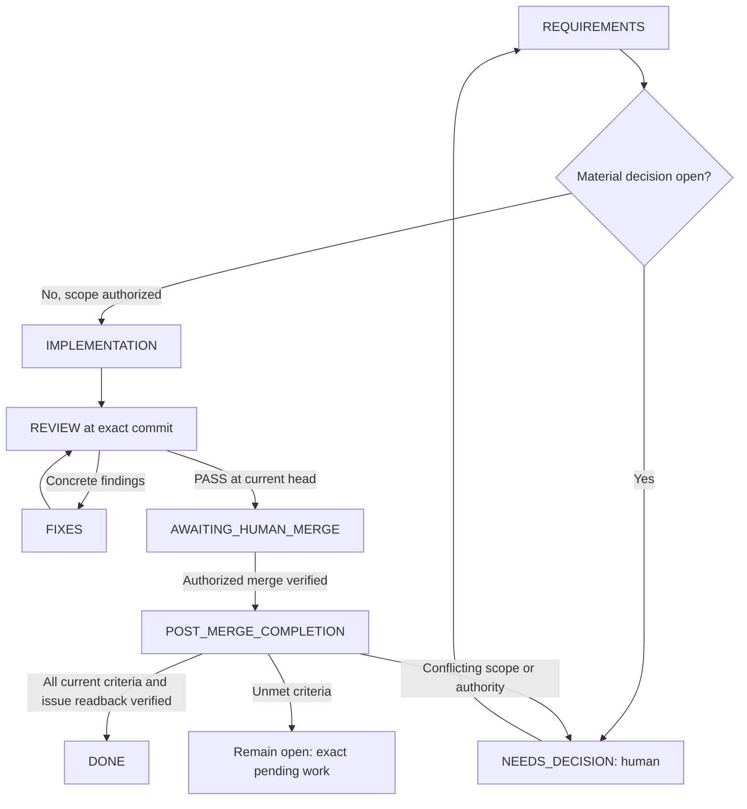

# Repository agents and human-in-the-loop workflow

This repository includes real Codex custom-agent definitions, not executable
WLED functionality. An active Codex session runs them. No autonomous daemon,
GitHub webhook, scheduled job or separate API application is installed.

## Files and runtime

| File | Responsibility |
| --- | --- |
| [.codex/agents/wled_requirements.toml](../.codex/agents/wled_requirements.toml) | Requirements and acceptance packet |
| [.codex/agents/wled_implementer.toml](../.codex/agents/wled_implementer.toml) | Scoped implementation and development tests |
| [.codex/agents/wled_reviewer.toml](../.codex/agents/wled_reviewer.toml) | Independent tests/review of a fixed candidate |
| [.codex/agents/wled_completion.toml](../.codex/agents/wled_completion.toml) | Evidenced issue checklist/state reconciliation after verified merge |
| [.codex/agents/wled_coordinator.toml](../.codex/agents/wled_coordinator.toml) | Reusable coordinator instructions |
| [.codex/config.toml](../.codex/config.toml) | Enable agents, cap concurrent child sessions at three |
| [Packet template](agent-workflow/packet.template.md) | Requirements, scope authorization, dependencies and ownership |
| [Implementation template](agent-workflow/implementation.template.md) | Candidate SHA and actual validation |
| [Review template](agent-workflow/review.template.md) | Independent findings, coverage and commit-specific verdict |
| [Completion template](agent-workflow/completion.template.md) | Merge equivalence, acceptance evidence and issue readback |
| [Shared decision log](DECISIONS.md) | Durable scoped decisions checked before repeated questions |
| [Issue decision records](decisions/README.md) | Issue-specific answers and supersession history |
| [Decision template](agent-workflow/decision.template.md) | Source, authority, scope, conditions and propagation |

Codex documents project-scoped custom agents under `.codex/agents/`, with `name`,
`description` and `developer_instructions`. Models, reasoning settings, provider,
MCP connections and permissions are inherited here: this setup pins none of them.
Role instructions are behavioral guidance, not OS-level read-only enforcement.
The project's config must be loaded/trusted under the client's normal mechanism;
managed/session policy can disable agents or restrict tools.

Source, checked 2026-11-04: [official Codex subagent documentation](https://learn.chatgpt.com/docs/agent-configuration/subagents).

## Start from a normal Codex session

Open this checkout in Codex. One sentence starts the defined issue workflow:

```text
Implement issue #2 and follow the defined workflow.
```

AGENTS.md routes issue implementation to this workflow by default. The main
session reads the coordinator role, retrieves the current issue/dependencies,
derives the stage, delegates requirements/implementation/review and presents the
reviewed PR for the human merge decision. The user does not need to repeat role
names, file paths, test steps, stage or existing merge rules in every request.
After verified authorized merge, the coordinator invokes `wled_completion` to
reconcile the selected issue's acceptance checklist and close fully satisfied
scope. This handoff does not require another routine approval.

For a requirements-only run, narrow the request explicitly:

```text
Prepare only the requirements for issue #2 using the defined workflow.
```

Only the issue identifier is needed; the coordinator derives stage context from
current labels, parent/ancestor trackers and the repository roadmap. Record that
evidence in the packet. Ask only for conflicting relevant metadata or genuinely
unclear scope, not for an unambiguous stage. Tooling issues outside the product
roadmap can be recorded as cross-stage without blocking otherwise clear work.

Substitute the issue deliberately; these examples are not implementation
authorization from merely reading this file. Already accepted scope decisions
remain valid and should not be requested again without a material change.

An actual implementation request authorizes work within that issue plus routine
tests and a reviewable PR. It does not automatically merge the PR, deploy services,
change physical devices or publish packages. Those boundaries are defined here,
not extra wording the user must append to the kickoff sentence.

The primary session is the coordinator so it can talk directly to the human.
Reading its role file is explicit guidance, not a claim that a root-session
`--agent` command exists. Delegate to named roles when the active client supports
selection. If a client's delegation tools cannot select custom names, explicitly
load/pass the corresponding role instructions and disclose that fallback. If
subagents are unavailable, provide a resumable packet and state the limitation;
do not claim an independent review occurred in a single context.

## State machine and decision points



1. Read current issue/comments, dependencies, docs and repository changes; derive
   stage context from labels/ancestor tracker/roadmap rather than user input.
2. Requirements agent creates a bounded packet. It identifies behavior decisions,
   not arbitrary additional approval gates. Reuse the human's accepted scope.
3. Implementer owns one branch/checkout and adds meaningful tests with changes.
   Missing device inventory does not block mockable work.
4. Once a candidate is committed, freeze its writes and review its full SHA.
   Reviewer independently inspects the diff and runs relevant checks. Additional
   test reproducers are returned as patches or developed in an explicitly
   separate assigned checkout; the reviewer does not repair production and
   approve the repair itself.
5. Route findings back for at most two correction rounds by default. If the same
   problem remains, return concrete findings/options to the human. Do not loop
   indefinitely, weaken requirements or remove tests merely to obtain PASS.
6. A passing review and human merge decision refer to the actual candidate. New
   commits invalidate previous review; refresh affected checks and approval as
   needed. Never merge automatically from an agent verdict.
7. After actual merge verification, hand off to `wled_completion`. DONE requires
   full current acceptance and verified issue body/state; a merged PR alone is
   insufficient. Partial completion keeps exact outstanding criteria visible.

The human accepts scope/important decisions, reviews the concrete final PR and
separately authorizes operational actions when wanted. Ordinary edits/tests within
accepted scope do not require repeated confirmation. Creating these agent files
does not commission the WLED backlog or start a workflow run.

## Post-merge issue completion

This step implements [issue #34](https://github.com/descipar/wled-mcp/issues/34),
PM-01–06, under DEC-006. The coordinator supplies the selected repository/issue,
packet, requirements/decision references, intended PR/target branch, full reviewed
SHA, passing review and actual human merge authority/reference. The completion
agent uses the [completion template](agent-workflow/completion.template.md).

- **PM-01/02:** Verify live identities, actual merge and intended target, then
  compare reviewed and integrated changes through history and scoped diff/tree/
  content evidence. Squash/rebase need not preserve SHA identity. Conflict-resolved
  or changed content needs refreshed review. Check the target's current content
  and history for reversion or invalidated acceptance before completion.
- **PM-03:** Re-read the current issue and relevant discussion/decisions; compare
  scope with the packet/review. Map every criterion to merged artifacts and
  appropriate validation. Check only proven items, report pending ones and close
  only satisfied current scope. Mocks do not prove required hardware acceptance;
  a merged child does not prove an epic/release complete. Never edit other issues
  or parent trackers as an incidental part of this step.
- **PM-04:** Preserve issue prose, unrelated checklist items and human edits.
  Record attributed criterion-to-evidence and merge references in one issue-body
  section delimited by `<!-- wled-completion:PR_NUMBER:start -->` and
  `<!-- wled-completion:PR_NUMBER:end -->`, substituting the actual PR number.
  Update that section in place; identical evidence and state produce no write,
  duplicate report or timestamp-only refresh. Do not post comments/messages.
  Re-read before each body/state write and recompute on concurrent changes;
  verify the body before closing and body/state afterward. API writes are not
  atomic. Failed/uncertain writes require re-read rather than blind replay.
- **PM-04 edge cases:** Already closed/auto-closed issues still need acceptance
  verification. If valid, reconcile missing evidence without redundant closure.
  Incomplete, reverted or invalidated closed issues return NEEDS_DECISION; never
  automatically reopen, undo human checklist decisions or reclose a human-reopened
  issue. Material scope changes invalidate stale completion evidence.
- **PM-05/06:** Run in an active/resumed authorized session when the coordinator
  observes the merge. No watcher, webhook, daemon or automatic merge is installed.
  If the session ends, preserve a resumable completion handoff. Missing access or
  unverifiable state yields BLOCKED/NEEDS_DECISION, never DONE. A static setup
  check does not prove live completion behavior.

Completion results are COMPLETED, INCOMPLETE, NEEDS_DECISION or BLOCKED. Only
COMPLETED, including final body/state readback, lets the coordinator record DONE.
An ordinary open issue with unmet criteria stays open in POST_MERGE_COMPLETION;
the handoff identifies exactly what remains instead of starting unrelated work.

## Shared files and durable handoffs

Spawned agents normally share a filesystem. A new agent does not automatically
mean a new branch, worktree, sandbox or independent credentials. Start serially
with one writer in the current suitable checkout. Parallelize read-only work;
parallel writers require actual isolated checkouts and clear integration ownership.
Follow the active host's worktree tools/rules when isolation is needed.

Use issue/PR bodies or clearly attributed agent comments for durable status when
that external write is within scope. Local transcripts/packets belong under
ignored `.agent-runs/`, never in a central output directory. Record requirement
reference, actual user-decision reference, branch, full candidate/reviewed SHA,
test evidence, correction rounds and next action. Do not copy personal identities
or private installation details into public-ready reports.

A human decision must come from a real user instruction or human review/comment;
agents must not fabricate approval comments, checkbox completion or identity.
An issue edit that changes the accepted behavior requires rechecking the packet.
Reviewing a different head cannot close the current implementation task.

## Learning from human answers

The workflow uses versioned project decisions rather than assumed automatic model
memory. All roles read [DECISIONS.md](DECISIONS.md) and relevant issue records at
startup/resume and before questions. The coordinator saves clear new answers,
records their source and narrow applicability, and explicitly forwards changed
decisions to the other roles. The full recording/lookup protocol is in the log.

Issue-specific answers stay scoped to the issue; general project/workflow rules
require an actual general decision or existing governing rule. Proposed or
ambiguous answers remain proposed/unresolved. Current human corrections supersede
older entries with a history link. Personal details and raw transcripts are not
copied into versioned records.

Routine recording within the current authorized workflow does not need another
confirmation for each entry. Material uncertainty about what the human decided
still needs clarification. A bounded merge/hardware/release permission cannot be
reused for a different candidate or a future operation merely because it is logged.

Decision updates travel with packet/requirements references. If they change
behavior, freeze dependent work and refresh relevant tests and review. Agents
must not claim that shared files alone updated another agent's active context,
or that a decision will survive a future session when it was never saved.

## Enforcement boundary and future automation

The coordinator is a model-guided workflow, not a tamper-proof state-machine
service. Repository role files cannot prevent a client with broad permissions
from ignoring them. No branch protection/ruleset, webhook, model billing account,
GitHub environment or scheduled runner is configured by this change.

For mechanical merge enforcement, a later authorized setup can require CI and
human review on the protected branch using the repository/account's available
controls. A later persistent orchestrator would also need stored run state,
event handling, credential boundaries and resource/cost limits. Start with a
single reviewed issue before adding that infrastructure.

## Validate this setup

```bash
python scripts/check_agent_setup.py
```

The checker parses TOML, verifies role names/required fields and local document
references, and rejects accidental model/provider/permission overrides. It does
not run an LLM, prove client discovery or exercise the full human approval loop.
Actual delegation needs an authorized live Codex session with the relevant tools.
Record such an end-to-end run separately; do not label static checks as agent
runtime acceptance or product/hardware evidence.

Setup verification on 2026-11-04: the checker passes and the available Codex CLI
0.146.0 completes `codex features list` from this checkout without a configuration
error. These checks do not establish that every desktop/CLI client has discovered
the named roles. Those initial setup checks did not exercise model delegation.
[PR #33](https://github.com/descipar/wled-mcp/pull/33), subsequently merged, records
an issue-2 contract/documentation run with independent review at candidate
`eae0e7ef4b83f458b43658044123a28ccd8a60a9`; its full review report was a local run
artifact. This is distinct from runtime, hardware or live completion-role evidence.
