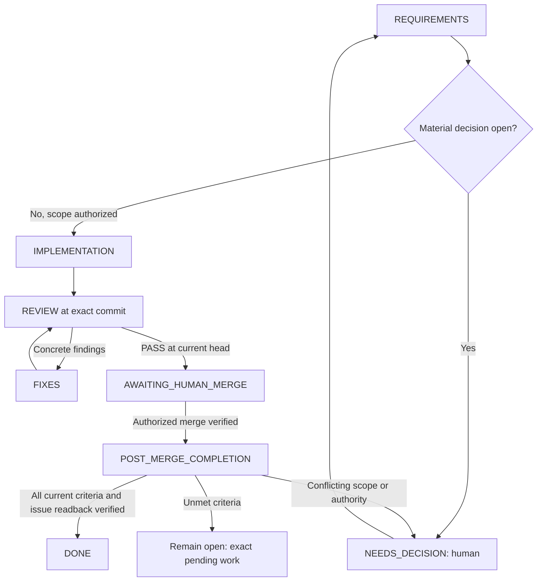

# Repository agents and human-in-the-loop workflow

The repository maintains shared role sources and complete native definitions for Codex and Claude Code. An active client session runs them; no daemon, webhook, scheduled job or API application is installed.

## Files and runtime

| File | Responsibility |
| --- | --- |
| [agents/requirements.md](../agents/requirements.md) | Requirements and acceptance packet |
| [agents/implementer.md](../agents/implementer.md) | Scoped implementation and tests |
| [agents/reviewer.md](../agents/reviewer.md) | Independent review of a fixed candidate |
| [agents/completion.md](../agents/completion.md) | Issue checklist reconciliation after verified merge |
| [agents/coordinator.md](../agents/coordinator.md) | Main-session coordinator instructions |
| [Shared-source maintenance](../agents/README.md) | Source format, sync, drift and failure policy |
| [Codex config](../.codex/config.toml) | Enables Codex agents, caps child sessions at three |
| [Claude entrypoint](../CLAUDE.md) | Imports the same AGENTS.md rules |
| [Packet](agent-workflow/packet.template.md), [implementation](agent-workflow/implementation.template.md), [review](agent-workflow/review.template.md), [completion](agent-workflow/completion.template.md), [decision](agent-workflow/decision.template.md) templates | Handoff formats |
| [Decision log](DECISIONS.md), [issue records](decisions/README.md) | Durable scoped decisions |

Edit only the five sources under `agents/`. `python scripts/sync_agents.py` generates the checked-in adapters `.codex/agents/*.toml` and `.claude/agents/*.md`; `--check` detects drift without writing (details in the maintenance guide). Models, reasoning, providers, MCP, tools and permissions are inherited from the client session; the adapters add no overrides. One delegation-time exception ([DEC-008](DECISIONS.md#dec-008--reviewer-on-opus-in-claude-code)): in Claude Code the coordinator launches `wled_reviewer` with Opus. Role text is guidance, not OS enforcement, and available files do not prove the runtime discovered the definitions.

## Starting a workflow

Open the checkout in either client. One sentence starts the issue workflow:

```text
Implement issue #2 and follow the defined workflow.
```

AGENTS.md routes issue implementation here by default. The main session reads `agents/coordinator.md`, retrieves the issue and dependencies, derives milestone context from the issue and [ROADMAP.md](ROADMAP.md), delegates requirements, implementation and review, and presents the reviewed PR for the human merge decision (or merges under an active standing approval, DEC-022). The user need not repeat roles, paths, test steps or merge rules. For a requirements-only run, say so explicitly. Reading this file is not implementation authorization. An implementation request authorizes work within the issue plus tests and a reviewable PR; it does not authorize merging, deployment, device changes or publication.

Every open or new issue carries exactly one milestone (Backlog counts) and no `Stage N: ` title prefix or `stage:N` label ([DEC-029](DECISIONS.md#dec-029--milestones-instead-of-stages)). Closing a milestone requires a minor release and a README update ([DEC-030](DECISIONS.md#dec-030--milestone-closure-includes-a-minor-release)); tag, publication and submissions stay owner-gated.

The primary session is the coordinator. If delegation cannot select custom names, load the complete `agents/*.md` instructions into the delegate and disclose the fallback; subagents need the bounded packet and decisions in their handoff. Without subagents, provide a resumable packet and never claim an independent review from a single context.

## State machine



1. Read the issue, comments, dependencies and docs; derive milestone context from the issue.
2. The requirements agent writes a bounded packet identifying behavior decisions, not extra approval gates; accepted scope is reused.
3. The implementer owns one branch/checkout and adds meaningful tests. Missing device inventory does not block mockable work.
4. After a candidate is committed, freeze its writes and review its full SHA. The reviewer inspects the diff and runs relevant checks; extra reproducers come back as patches, and the reviewer does not repair production code.
5. Route findings back for at most two correction rounds, then return findings/options to the maintainer. Never weaken requirements or remove tests to obtain PASS.
6. Review and merge decisions refer to the actual candidate; new commits invalidate the review. No automatic merge from an agent verdict, except under an owner-granted standing approval and its conditions (DEC-022 item 4). With the DEC-024 rulesets the squash merge uses `--admin` (the owner's bypass), only for an owner-approved or covered merge.
7. After verified merge, hand off to `wled_completion`; DONE needs full current acceptance and verified issue body/state. A merged PR alone is insufficient.

The maintainer accepts scope and important decisions, reviews the final PR and separately authorizes operational actions.

## Post-merge issue completion

Implements [issue #34](https://github.com/descipar/wled-mcp/issues/34), PM-01 to PM-06, under DEC-006. The coordinator supplies repository/issue, packet, decision references, PR/target branch, reviewed SHA, passing review and the merge authority. The completion agent uses the [completion template](agent-workflow/completion.template.md).

- **PM-01/02:** Verify the actual merge and target; compare reviewed and integrated changes by history and scoped diff/tree evidence (squash/rebase need not preserve SHAs). Conflict-resolved or changed content needs a refreshed review. Check the target for reversion or invalidated acceptance.
- **PM-03:** Re-read the issue and decisions, map every criterion to merged artifacts and validation, check only proven items, report pending ones and close only satisfied current scope. Mocks do not prove required hardware acceptance; a merged child does not complete an epic/release. Never edit other issues or trackers incidentally.
- **PM-04:** Preserve issue prose, unrelated checklist items and human edits. Record criterion-to-evidence and merge references in one body section delimited by `<!-- wled-completion:PR_NUMBER:start -->` and `<!-- wled-completion:PR_NUMBER:end -->` (actual PR number), updated in place; identical evidence and state produce no write, duplicate report or timestamp refresh. No comments. Re-read before each write, verify the body before closing and body/state afterward; failed or uncertain writes need a re-read, not a blind replay. Already closed issues still need acceptance verification; incomplete, reverted or invalidated closed issues return NEEDS_DECISION and are never reopened automatically or reclosed against a human reopen. Material scope changes invalidate stale evidence.
- **PM-05/06:** Runs in an active session that observes the merge; no watcher or automatic merge exists. If the session ends, preserve a resumable handoff. Missing access or unverifiable state yields BLOCKED/NEEDS_DECISION, never DONE.

Results: COMPLETED, INCOMPLETE, NEEDS_DECISION or BLOCKED; only COMPLETED with final readback lets the coordinator record DONE.

## Shared files, parallel work and branches

Spawned agents share a filesystem; a new agent is not a new branch, worktree or credential. Start with one writer per checkout, parallelize read-only work, and use actual isolated checkouts with clear integration ownership for parallel writers. Stage 2 ran under [DEC-021](DECISIONS.md#dec-021--adopt-the-stage-2-parallel-plan) ([plan](STAGE-2-PARALLEL-PLAN.md); "Starte Stage 2 parallel" resumes it, see [coordinator.md](../agents/coordinator.md)).

Branch model ([DEC-039](DECISIONS.md#dec-039--main-is-the-integration-line-releases-are-tags)): no long-lived milestone branch; each issue is a short-lived feature branch merged into `main` one PR at a time. `main` is green (CI plus a current-head PASS under the DEC-022 sync rule) but not necessarily release-ready at every commit. A release is a `v<version>` tag on a reviewed `main` commit ([PUBLISHING.md](PUBLISHING.md)), staged on the target machine (DEC-026) and owner-gated. A change that is not usable alone is split or kept behind an off-by-default option; tightly coupled issues may use stacked PRs; an incompatible change needing an integration branch goes to the owner first.

[DEC-028](DECISIONS.md#dec-028--pragmatic-delivery): good enough, not 100%; scope, evidence and review depth are fixed up front, one or two evidence runs instead of matrices, nits and polish go to the next PR; safety gates stay. [DEC-022](DECISIONS.md#dec-022--proportionate-review-and-standing-merge-approval): nits do not trigger a new round, a sync without own code changes keeps the PASS after the coordinator's diff check, docs-only PRs get a light review, and while the standing merge approval is active the coordinator merges PRs with a current-head PASS and green CI and revalidates the approval with the owner after three issues.

### Where new documentation goes

New documentation goes into new files so parallel tracks do not edit the same large documents:

| Content | Location | Linked from |
| --- | --- | --- |
| New tool or transport contract | `docs/contract/<area>.md` | [TOOL-CONTRACT.md](TOOL-CONTRACT.md) |
| New validation or acceptance evidence | `docs/validation/issue-<n>.md` | [VALIDATION.md](VALIDATION.md) |
| Issue-specific decisions | `docs/decisions/issue-<n>.md` | [DECISIONS.md](DECISIONS.md) |

The creating PR adds one link line, in sorted position, to the "Stage 2 and later files" list of the contract or validation document; decision files get the usual pointer in DECISIONS.md. Existing sections stay in place and small corrections are made there.

Use issue/PR bodies or attributed agent comments for durable status. Local transcripts and packets belong under ignored `.agent-runs/`. Record requirement reference, user-decision reference, branch, full candidate SHA, test evidence, correction rounds and next action, without personal identities or private installation details. A human decision must come from a real user instruction or review; agents never fabricate approval, checkbox completion or identity. An issue edit that changes accepted behavior requires rechecking the packet.

## Learning from human answers

All roles read [DECISIONS.md](DECISIONS.md) and the relevant issue records at startup/resume and before questions; the coordinator records clear answers with source and narrow applicability and forwards changes to the other roles (recording protocol in the log). Issue answers stay scoped to the issue; proposed or ambiguous answers stay proposed; newer human corrections supersede older entries with a history link; personal details and raw transcripts are not recorded. Routine recording needs no extra confirmation, but a bounded merge/hardware/release permission is never reused for another candidate or operation. Decision updates that change behavior freeze dependent work and refresh tests and review. Shared files alone do not update another agent's active context.

## Enforcement boundary

The coordinator is a model-guided workflow, not a tamper-proof state machine; role files cannot stop a client with broad permissions from ignoring them. Mechanical merge enforcement comes from the repository rulesets and CI (DEC-024), and a persistent orchestrator would need run state, credential boundaries and cost limits.

## Validate this setup

```bash
python scripts/check_agent_setup.py
python scripts/sync_agents.py --check
python -m unittest discover -s tests -p "test_sync_agents.py"
```

The checker validates the Codex TOML, shared source metadata, exact generated parity for both formats, the Claude import and local references, and rejects model/provider/permission overrides. These static checks run no LLM and do not prove client discovery, native role discovery or the human approval loop; record a live end-to-end run separately and never label static checks as agent runtime, product or hardware evidence. Agent Teams are not required.
