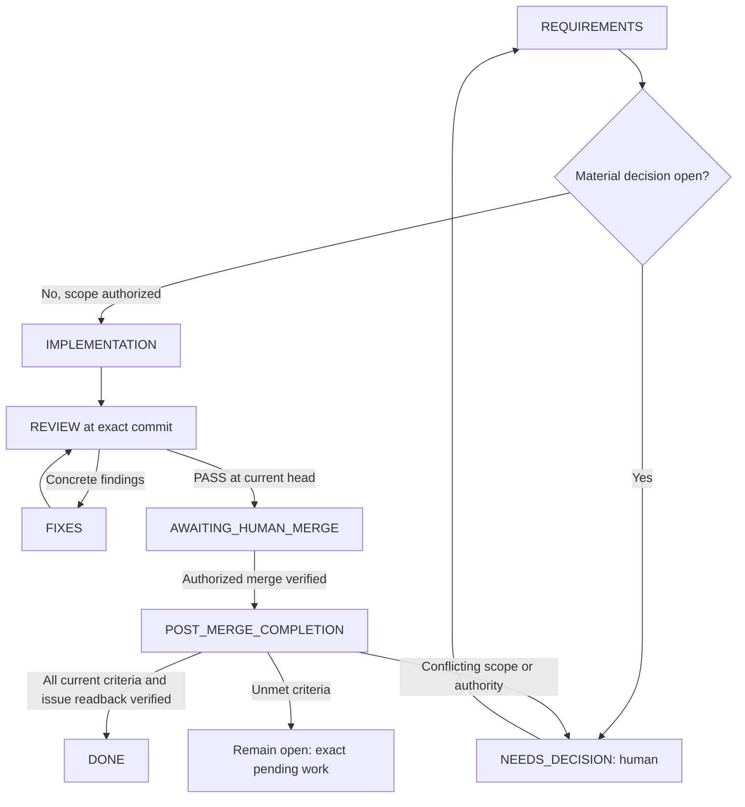

# Repository agents and human-in-the-loop workflow

This repository maintains shared role sources and complete native definitions for
Codex and Claude Code, not executable WLED functionality. An active client session
runs them. No autonomous daemon,
GitHub webhook, scheduled job or separate API application is installed.

## Files and runtime

| File | Responsibility |
| --- | --- |
| [agents/requirements.md](../agents/requirements.md) | Requirements and acceptance packet |
| [agents/implementer.md](../agents/implementer.md) | Scoped implementation and development tests |
| [agents/reviewer.md](../agents/reviewer.md) | Independent tests/review of a fixed candidate |
| [agents/completion.md](../agents/completion.md) | Evidenced issue checklist/state reconciliation after verified merge |
| [agents/coordinator.md](../agents/coordinator.md) | Main-session coordinator instructions |
| [Shared-source maintenance](../agents/README.md) | Source format, deterministic sync, drift and failure policy |
| [Codex config](../.codex/config.toml) | Enable Codex agents, cap concurrent child sessions at three |
| [Claude entrypoint](../CLAUDE.md) | Import the same AGENTS.md rules into Claude Code |
| [Packet template](agent-workflow/packet.template.md) | Requirements, scope authorization, dependencies and ownership |
| [Implementation template](agent-workflow/implementation.template.md) | Candidate SHA and actual validation |
| [Review template](agent-workflow/review.template.md) | Independent findings, coverage and commit-specific verdict |
| [Completion template](agent-workflow/completion.template.md) | Merge equivalence, acceptance evidence and issue readback |
| [Shared decision log](DECISIONS.md) | Durable scoped decisions checked before repeated questions |
| [Issue decision records](decisions/README.md) | Issue-specific answers and supersession history |
| [Decision template](agent-workflow/decision.template.md) | Source, authority, scope, conditions and propagation |

Edit only the five sources under `agents/`. `python scripts/sync_agents.py`
generates full prompts in `.codex/agents/*.toml` (`name`, `description`,
`developer_instructions`) and `.claude/agents/*.md` (YAML identity/description,
Markdown prompt). These are checked-in generated adapters, not independently
maintained copies or pointer-only roles. `--check` detects drift without writing.
Python 3.11+ standard library suffices; source CRLF is normalized to LF, and the
existing Git attributes keep adapter checkouts at LF. See the maintenance guide
for input validation, preserved unrelated files and nontransactional batch failures.

Models, reasoning, providers, MCP, tools and permissions remain inherited from
each client/session; the adapters add no overrides. Client trust/loading and
managed/session policy still apply. One delegation-time exception is recorded in
[DEC-008](DECISIONS.md#dec-008--reviewer-on-opus-in-claude-code): in Claude Code the
coordinator launches `wled_reviewer` with Opus; Codex is unaffected and the adapters
still carry no model field. Role text is guidance, not OS enforcement.
Claude's [documented `@AGENTS.md` import](https://code.claude.com/docs/en/memory#import-additional-files)
keeps the project rules shared even on versions without direct AGENTS.md support.
Client registration formats: [Codex subagents](https://learn.chatgpt.com/docs/agent-configuration/subagents),
[Claude Code subagents](https://code.claude.com/docs/en/sub-agents), checked 2026-11-04.
Reload/restart as required by the installed client; availability of these files
does not prove that the active runtime discovered the definitions.

## Start from a normal Codex or Claude Code session

Open this checkout in either client. One sentence starts the same issue workflow:

```text
Implement issue #2 and follow the defined workflow.
```

AGENTS.md routes issue implementation to this workflow by default. The main
session reads `agents/coordinator.md`, retrieves the current issue/dependencies,
derives the stage, delegates requirements/implementation/review and presents the
reviewed PR for the human merge decision (or merges it under an active standing
approval, DEC-022). The user does not need to repeat role
names, file paths, test steps, stage or existing merge rules in every request.
After verified authorized merge, the coordinator invokes `wled_completion` to
reconcile the selected issue's acceptance checklist and close fully satisfied
scope. This handoff does not require another routine approval.

For a requirements-only run, narrow the request explicitly:

```text
Prepare only the requirements for issue #2 using the defined workflow.
```

Only the issue identifier is needed; the coordinator derives milestone context from
the issue's milestone and the repository roadmap ([ROADMAP.md](ROADMAP.md)); older
closed issues keep their stage label and tracker. Record that
evidence in the packet. Ask only for conflicting relevant metadata or genuinely
unclear scope, not for an unambiguous milestone. Every open or new issue carries
exactly one milestone, Backlog counting ([DEC-029](DECISIONS.md#dec-029--milestones-instead-of-stages)),
and no `Stage N: ` title prefix or `stage:N` label; workflow/tooling issues get a
milestone like any other issue. Closing a milestone requires at least a minor release
and a README update ([DEC-030](DECISIONS.md#dec-030--milestone-closure-includes-a-minor-release));
tag, release publication and submissions stay owner-gated, so the coordinator prepares them and asks.

Substitute the issue deliberately; these examples are not implementation
authorization from merely reading this file. Already accepted scope decisions
remain valid and should not be requested again without a material change.

An actual implementation request authorizes work within that issue plus routine
tests and a reviewable PR. It does not automatically merge the PR, deploy services,
change physical devices or publish packages. Those boundaries are defined here,
not extra wording the user must append to the kickoff sentence.

The primary session is the coordinator so it can talk directly to the maintainer.
Reading the shared coordinator source is explicit main-session guidance, independent
of any client-specific root-agent flag. Delegate to named roles when the client supports
selection. If a client's delegation tools cannot select custom names, explicitly
load/pass the complete corresponding `agents/*.md` instructions and disclose that
fallback; do not claim native definition loading. Claude subagents need the bounded
packet and decisions in their handoff rather than assumed prior chat history. If
subagents are unavailable, provide a resumable packet and state the limitation;
do not claim an independent review occurred in a single context.

## State machine and decision points



1. Read current issue/comments, dependencies, docs and repository changes; derive
   milestone context from the issue milestone/roadmap rather than user input.
2. Requirements agent creates a bounded packet. It identifies behavior decisions,
   not arbitrary additional approval gates. Reuse the maintainer's accepted scope.
3. Implementer owns one branch/checkout and adds meaningful tests with changes.
   Missing device inventory does not block mockable work.
4. Once a candidate is committed, freeze its writes and review its full SHA.
   Reviewer independently inspects the diff and runs relevant checks. Additional
   test reproducers are returned as patches or developed in an explicitly
   separate assigned checkout; the reviewer does not repair production and
   approve the repair itself.
5. Route findings back for at most two correction rounds by default. If the same
   problem remains, return concrete findings/options to the maintainer. Do not loop
   indefinitely, weaken requirements or remove tests merely to obtain PASS.
6. A passing review and human merge decision refer to the actual candidate. New
   commits invalidate previous review; refresh affected checks and approval as
   needed. Never merge automatically from an agent verdict, except under an active
   owner-granted standing approval and its conditions (DEC-022 item 4). With the
   DEC-024 rulesets the squash merge is refused without an approving review and then
   uses `--admin` (the owner's bypass), only for an owner-approved or covered merge.
7. After actual merge verification, hand off to `wled_completion`. DONE requires
   full current acceptance and verified issue body/state; a merged PR alone is
   insufficient. Partial completion keeps exact outstanding criteria visible.

The maintainer accepts scope/important decisions, reviews the concrete final PR and
separately authorizes operational actions when wanted. Ordinary edits/tests within
accepted scope do not require repeated confirmation. Creating these agent files
does not commission the WLED backlog or start a workflow run.

## Post-merge issue completion

This step implements [issue #34](https://github.com/descipar/wled-mcp/issues/34),
PM-01–06, under DEC-006. The coordinator supplies the selected repository/issue,
packet, requirements/decision references, intended PR/target branch, full reviewed
SHA, passing review and actual human merge authority/reference. The completion
agent uses the [completion template](agent-workflow/completion.template.md).

- **PM-01/02:** Verify live identities, actual merge and intended target, then
  compare reviewed and integrated changes through history and scoped diff/tree/
  content evidence. Squash/rebase need not preserve SHA identity. Conflict-resolved
  or changed content needs refreshed review. Check the target's current content
  and history for reversion or invalidated acceptance before completion.
- **PM-03:** Re-read the current issue and relevant discussion/decisions; compare
  scope with the packet/review. Map every criterion to merged artifacts and
  appropriate validation. Check only proven items, report pending ones and close
  only satisfied current scope. Mocks do not prove required hardware acceptance;
  a merged child does not prove an epic/release complete. Never edit other issues
  or parent trackers as an incidental part of this step.
- **PM-04:** Preserve issue prose, unrelated checklist items and human edits.
  Record attributed criterion-to-evidence and merge references in one issue-body
  section delimited by `<!-- wled-completion:PR_NUMBER:start -->` and
  `<!-- wled-completion:PR_NUMBER:end -->`, substituting the actual PR number.
  Update that section in place; identical evidence and state produce no write,
  duplicate report or timestamp-only refresh. Do not post comments/messages.
  Re-read before each body/state write and recompute on concurrent changes;
  verify the body before closing and body/state afterward. API writes are not
  atomic. Failed/uncertain writes require re-read rather than blind replay.
- **PM-04 edge cases:** Already closed/auto-closed issues still need acceptance
  verification. If valid, reconcile missing evidence without redundant closure.
  Incomplete, reverted or invalidated closed issues return NEEDS_DECISION; never
  automatically reopen, undo human checklist decisions or reclose a human-reopened
  issue. Material scope changes invalidate stale completion evidence.
- **PM-05/06:** Run in an active/resumed authorized session when the coordinator
  observes the merge. No watcher, webhook, daemon or automatic merge is installed.
  If the session ends, preserve a resumable completion handoff. Missing access or
  unverifiable state yields BLOCKED/NEEDS_DECISION, never DONE. A static setup
  check does not prove live completion behavior.

Completion results are COMPLETED, INCOMPLETE, NEEDS_DECISION or BLOCKED. Only
COMPLETED, including final body/state readback, lets the coordinator record DONE.
An ordinary open issue with unmet criteria stays open in POST_MERGE_COMPLETION;
the handoff identifies exactly what remains instead of starting unrelated work.

## Shared files and durable handoffs

Spawned agents normally share a filesystem. A new agent does not automatically
mean a new branch, worktree, sandbox or independent credentials. Start serially
with one writer in the current suitable checkout. Parallelize read-only work;
parallel writers require actual isolated checkouts and clear integration ownership.
Follow the active host's worktree tools/rules when isolation is needed.

For stage 2, [DEC-021](DECISIONS.md#dec-021--adopt-the-stage-2-parallel-plan) adopts
[the parallel plan](STAGE-2-PARALLEL-PLAN.md): the main session is the integration
owner, at most two implementation tracks run in isolated worktrees with one
coordinator per issue, branches are kept current by merging `main` (no force-push),
and "Starte Stage 2 parallel" starts or resumes the plan (see
[coordinator.md](../agents/coordinator.md)).
[DEC-028](DECISIONS.md#dec-028--pragmatic-delivery) asks for good enough instead of 100%: scope, evidence
and review depth are fixed up front, evidence is one or two runs instead of matrices, optional polish
and nits go to the next PR, and small follow-ups are folded into the open PR; the safety gates stay.
[DEC-022](DECISIONS.md#dec-022--proportionate-review-and-standing-merge-approval)
keeps review proportionate: nits go to the next PR instead of a new round, a sync
without own code changes keeps the PASS after the coordinator's diff check, and
docs-only PRs get a light review. While its standing merge approval is active, the
coordinator merges PRs with a current-head PASS and green CI without asking and
revalidates the approval with the owner after three issues.

### Where new documentation goes

From stage 2 on, new documentation goes into new files so that parallel tracks do
not edit the same large documents (plan step (d) of DEC-021):

| Content | Location | Linked from |
| --- | --- | --- |
| New tool or transport contract | `docs/contract/<area>.md`, one file per area (for example `segments.md`) | [TOOL-CONTRACT.md](TOOL-CONTRACT.md) |
| New validation or acceptance evidence | `docs/validation/issue-<n>.md` | [VALIDATION.md](VALIDATION.md) |
| Issue-specific decisions | `docs/decisions/issue-<n>.md` | [DECISIONS.md](DECISIONS.md) |

The PR that creates such a file adds one link line, in sorted position, to the
"Stage 2 and later files" list at the end of the contract or validation document;
decision files get the usual pointer in DECISIONS.md.
Existing sections stay where they are; nothing is moved. A small correction to an
existing section is still made in place.

Use issue/PR bodies or clearly attributed agent comments for durable status when
that external write is within scope. Local transcripts/packets belong under
ignored `.agent-runs/`, never in a central output directory. Record requirement
reference, actual user-decision reference, branch, full candidate/reviewed SHA,
test evidence, correction rounds and next action. Do not copy personal identities
or private installation details into public-ready reports.

A human decision must come from a real user instruction or human review/comment;
agents must not fabricate approval comments, checkbox completion or identity.
An issue edit that changes the accepted behavior requires rechecking the packet.
Reviewing a different head cannot close the current implementation task.

## Learning from human answers

The workflow uses versioned project decisions rather than assumed automatic model
memory. All roles read [DECISIONS.md](DECISIONS.md) and relevant issue records at
startup/resume and before questions. The coordinator saves clear new answers,
records their source and narrow applicability, and explicitly forwards changed
decisions to the other roles. The full recording/lookup protocol is in the log.

Issue-specific answers stay scoped to the issue; general project/workflow rules
require an actual general decision or existing governing rule. Proposed or
ambiguous answers remain proposed/unresolved. Current human corrections supersede
older entries with a history link. Personal details and raw transcripts are not
copied into versioned records.

Routine recording within the current authorized workflow does not need another
confirmation for each entry. Material uncertainty about what the maintainer decided
still needs clarification. A bounded merge/hardware/release permission cannot be
reused for a different candidate or a future operation merely because it is logged.

Decision updates travel with packet/requirements references. If they change
behavior, freeze dependent work and refresh relevant tests and review. Agents
must not claim that shared files alone updated another agent's active context,
or that a decision will survive a future session when it was never saved.

## Enforcement boundary and future automation

The coordinator is a model-guided workflow, not a tamper-proof state-machine
service. Repository role files cannot prevent a client with broad permissions
from ignoring them. No branch protection/ruleset, webhook, model billing account,
GitHub environment or scheduled runner is configured by this change.

For mechanical merge enforcement, a later authorized setup can require CI and
human review on the protected branch using the repository/account's available
controls. A later persistent orchestrator would also need stored run state,
event handling, credential boundaries and resource/cost limits. Start with a
single reviewed issue before adding that infrastructure.

## Validate this setup

```bash
python scripts/check_agent_setup.py
python scripts/sync_agents.py --check
python -m unittest discover -s tests -p "test_sync_agents.py"
```

The checker parses Codex TOML, validates shared source metadata and exact generated
parity for both native formats, checks the Claude import and local references,
and rejects accidental model/provider/permission overrides. Tooling tests exercise
format fidelity, Unicode/escaping, CRLF, drift/no-op writes, invalid-input preflight,
preservation and write failures. These checks do
not run an LLM, prove client discovery or exercise the full human approval loop.
Actual delegation needs an authorized live client session with the relevant tools.
Record such an end-to-end run separately; do not label static checks as agent
runtime acceptance or product/hardware evidence.

Setup verification on 2026-11-04: the checker passes and the available Codex CLI
0.146.0 completes `codex features list` from this checkout without a configuration
error. These checks do not establish that every desktop/CLI client has discovered
the named roles. Those initial setup checks did not exercise model delegation.
[PR #33](https://github.com/descipar/wled-mcp/pull/33), subsequently merged, records
an issue-2 contract/documentation run with independent review at candidate
`eae0e7ef4b83f458b43658044123a28ccd8a60a9`; its full review report was a local run
artifact. This is distinct from runtime, hardware or live completion-role evidence.

For shared-role setup, local Codex 0.166.0 and Claude Code 2.1.150 were inspected
without model launches. Version/help output does not establish native role
discovery. In particular, `claude agents` on that version manages live sessions;
its JSON output is not a custom-definition inventory. Native discovery and live
Claude workflow behavior require separate evidence; Agent Teams are not required.
