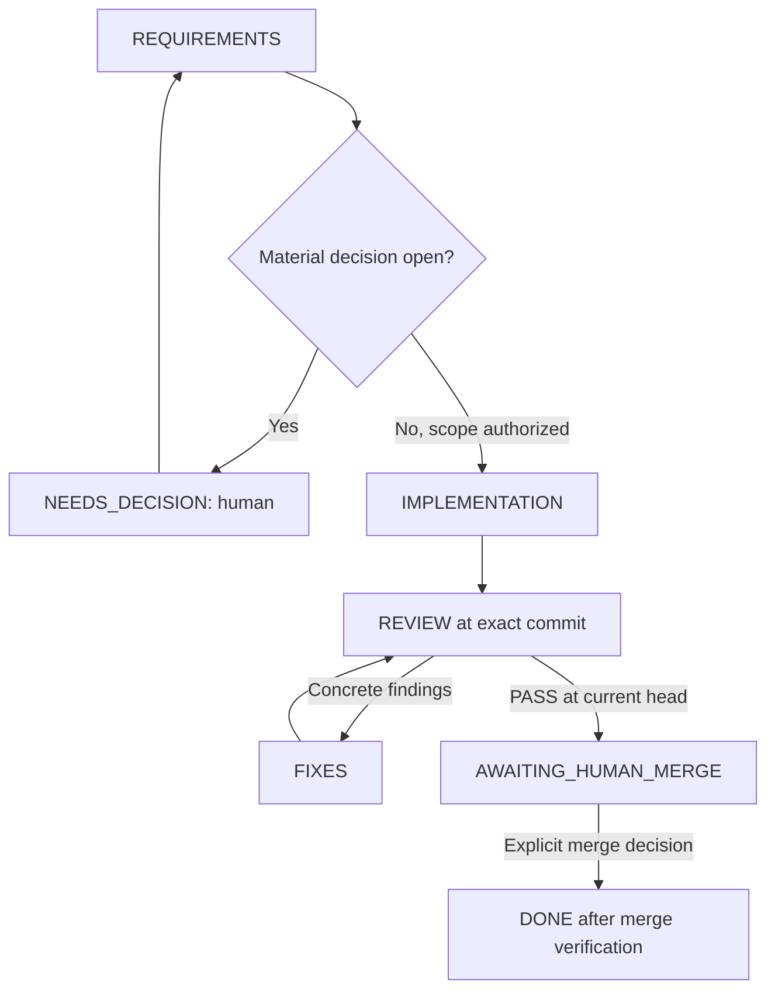

# Repository agents and human-in-the-loop workflow

This repository includes real Codex custom-agent definitions, not executable
WLED functionality. An active Codex session runs them. No autonomous daemon,
GitHub webhook, scheduled job or separate API application is installed.

## Files and runtime

| File | Responsibility |
| --- | --- |
| [.codex/agents/wled_requirements.toml](../.codex/agents/wled_requirements.toml) | Requirements and acceptance packet |
| [.codex/agents/wled_implementer.toml](../.codex/agents/wled_implementer.toml) | Scoped implementation and development tests |
| [.codex/agents/wled_reviewer.toml](../.codex/agents/wled_reviewer.toml) | Independent tests/review of a fixed candidate |
| [.codex/agents/wled_coordinator.toml](../.codex/agents/wled_coordinator.toml) | Reusable coordinator instructions |
| [.codex/config.toml](../.codex/config.toml) | Enable agents, cap concurrent child sessions at three |
| [Packet template](agent-workflow/packet.template.md) | Requirements, scope authorization, dependencies and ownership |
| [Implementation template](agent-workflow/implementation.template.md) | Candidate SHA and actual validation |
| [Review template](agent-workflow/review.template.md) | Independent findings, coverage and commit-specific verdict |

Codex documents project-scoped custom agents under `.codex/agents/`, with `name`,
`description` and `developer_instructions`. Models, reasoning settings, provider,
MCP connections and permissions are inherited here: this setup pins none of them.
Role instructions are behavioral guidance, not OS-level read-only enforcement.
The project's config must be loaded/trusted under the client's normal mechanism;
managed/session policy can disable agents or restrict tools.

Source, checked 2026-11-04: [official Codex subagent documentation](https://learn.chatgpt.com/docs/agent-configuration/subagents).

## Start from a normal Codex session

Open this checkout in Codex. Use this kickoff prompt for a requirements-only run:

```text
Act as the primary coordinator for WLED MCP issue #2.
Read AGENTS.md, docs/AGENT-WORKFLOW.md and the developer_instructions in
.codex/agents/wled_coordinator.toml as task guidance.
Delegate requirements analysis to wled_requirements.
Prepare a work packet only; do not implement or merge anything yet.
```

When implementation is actually desired, use an explicit scope such as:

```text
Coordinate implementation of issue #2 within its existing scope.
Use the repository workflow and roles: wled_requirements, wled_implementer and
wled_reviewer. Resolve material contract questions with me; perform routine
implementation and mocked tests autonomously. Present the reviewed PR for my
merge decision. Do not deploy, change physical devices or publish packages.
```

Only the issue identifier is needed; the coordinator derives stage context from
current labels, parent/ancestor trackers and the repository roadmap. Record that
evidence in the packet. Ask only for conflicting relevant metadata or genuinely
unclear scope, not for an unambiguous stage. Tooling issues outside the product
roadmap can be recorded as cross-stage without blocking otherwise clear work.

A minimal implementation kickoff is:

```text
Implement issue #2 using the repository agent workflow.
Present the independently reviewed PR for my merge decision.
```

Substitute the issue deliberately; these examples are not implementation
authorization from merely reading this file. Already accepted scope decisions
remain valid and should not be requested again without a material change.

The primary session is the coordinator so it can talk directly to the human.
Reading its role file is explicit guidance, not a claim that a root-session
`--agent` command exists. Delegate to named roles when the active client supports
selection. If a client's delegation tools cannot select custom names, explicitly
load/pass the corresponding role instructions and disclose that fallback. If
subagents are unavailable, provide a resumable packet and state the limitation;
do not claim an independent review occurred in a single context.

## State machine and decision points



1. Read current issue/comments, dependencies, docs and repository changes; derive
   stage context from labels/ancestor tracker/roadmap rather than user input.
2. Requirements agent creates a bounded packet. It identifies behavior decisions,
   not arbitrary additional approval gates. Reuse the human's accepted scope.
3. Implementer owns one branch/checkout and adds meaningful tests with changes.
   Missing device inventory does not block mockable work.
4. Once a candidate is committed, freeze its writes and review its full SHA.
   Reviewer independently inspects the diff and runs relevant checks. Additional
   test reproducers are returned as patches or developed in an explicitly
   separate assigned checkout; the reviewer does not repair production and
   approve the repair itself.
5. Route findings back for at most two correction rounds by default. If the same
   problem remains, return concrete findings/options to the human. Do not loop
   indefinitely, weaken requirements or remove tests merely to obtain PASS.
6. A passing review and human merge decision refer to the actual candidate. New
   commits invalidate previous review; refresh affected checks and approval as
   needed. Never merge automatically from an agent verdict.

The human accepts scope/important decisions, reviews the concrete final PR and
separately authorizes operational actions when wanted. Ordinary edits/tests within
accepted scope do not require repeated confirmation. Creating these agent files
does not commission the WLED backlog or start a workflow run.

## Shared files and durable handoffs

Spawned agents normally share a filesystem. A new agent does not automatically
mean a new branch, worktree, sandbox or independent credentials. Start serially
with one writer in the current suitable checkout. Parallelize read-only work;
parallel writers require actual isolated checkouts and clear integration ownership.
Follow the active host's worktree tools/rules when isolation is needed.

Use issue/PR bodies or clearly attributed agent comments for durable status when
that external write is within scope. Local transcripts/packets belong under
ignored `.agent-runs/`, never in a central output directory. Record requirement
reference, actual user-decision reference, branch, full candidate/reviewed SHA,
test evidence, correction rounds and next action. Do not copy personal identities
or private installation details into public-ready reports.

A human decision must come from a real user instruction or human review/comment;
agents must not fabricate approval comments, checkbox completion or identity.
An issue edit that changes the accepted behavior requires rechecking the packet.
Reviewing a different head cannot close the current implementation task.

## Enforcement boundary and future automation

The coordinator is a model-guided workflow, not a tamper-proof state-machine
service. Repository role files cannot prevent a client with broad permissions
from ignoring them. No branch protection/ruleset, webhook, model billing account,
GitHub environment or scheduled runner is configured by this change.

For mechanical merge enforcement, a later authorized setup can require CI and
human review on the protected branch using the repository/account's available
controls. A later persistent orchestrator would also need stored run state,
event handling, credential boundaries and resource/cost limits. Start with a
single reviewed issue before adding that infrastructure.

## Validate this setup

```bash
python scripts/check_agent_setup.py
```

The checker parses TOML, verifies role names/required fields and local document
references, and rejects accidental model/provider/permission overrides. It does
not run an LLM, prove client discovery or exercise the full human approval loop.
Actual delegation needs an authorized live Codex session with the relevant tools.
Record such an end-to-end run separately; do not label static checks as agent
runtime acceptance or product/hardware evidence.

Setup verification on 2026-11-04: the checker passes and the available Codex CLI
0.146.0 completes `codex features list` from this checkout without a configuration
error. These checks do not establish that every desktop/CLI client has discovered
the named roles. No end-to-end model delegation or implementation run was executed.
