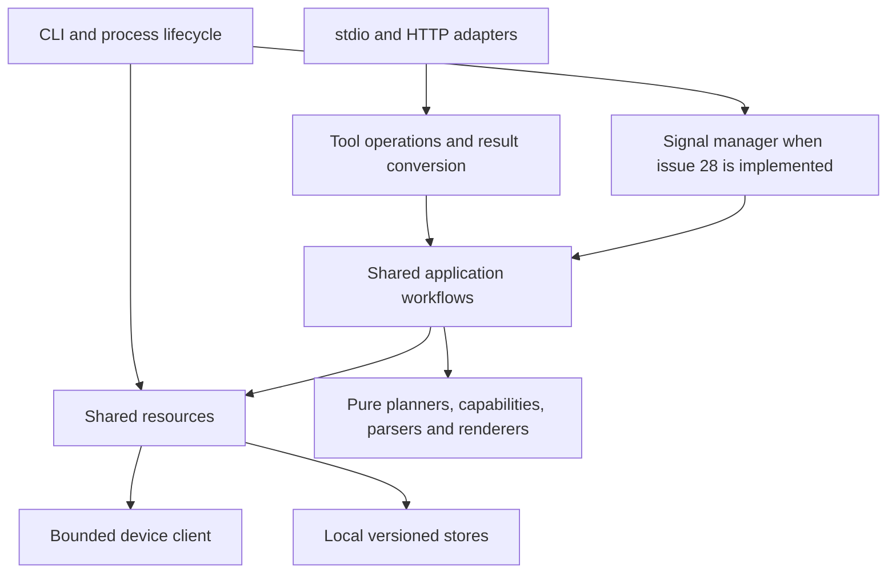

# Architecture review — 2026-11-09

## Assessment

The architecture is suitable for the current product and the planned milestones. Keep
the single-process Python service, shared domain operations, explicit inventory and local
JSON storage. A rewrite, database, message broker or separate service per feature would
add cost without solving the next issues.

The main weakness is where shared behavior lives: application workflows have accumulated
inside tool-factory modules, while several public payloads remain loosely described JSON.
Upcoming features should extract small shared pieces when they need them. The largest
architectural step is temporary signals (#28): it introduces work that outlives a tool
request and needs explicit lifecycle and restoration semantics before implementation.

No critical runtime defect was established by this architecture review. The findings below
distinguish existing weaknesses from prerequisites for features that do not exist yet.
They are recommendations, not new owner decisions or authorization to implement them.

## Baseline, scope and method

- Reviewed commit: [`0bdf3efbb6d6eaf5c98313915279fa5b857b9219`](https://github.com/descipar/wled-mcp/commit/0bdf3efbb6d6eaf5c98313915279fa5b857b9219).
- The review started after PR [#153](https://github.com/descipar/wled-mcp/pull/153)
  merged at 18:45:04 UTC and PR [#146](https://github.com/descipar/wled-mcp/pull/146)
  merged at 18:50:03 UTC. No open PR remained when checked. The clean review branch was
  advanced to that `main` commit before inspecting the architecture.
- GitHub inventory: 64 issues, including 16 open issues. Every open issue's body was
  considered; comments on open issues with comments were also read. Closed issues were
  used as delivery/decision context, particularly #2–#21, #27, #31, #67, #98, #130,
  #131 and #134. A closed superseded tracker does not imply delivery of its children.
- Current GitHub milestone membership was checked directly. It supersedes old stage
  scheduling text under DEC-029. This includes #154 in Backlog, although it is absent
  from the repository's roadmap table.
- Inspection covered composition, transports and access, bounded client requests,
  planning/write verification, catalogs, scenes/zones, storage, diagnostics, compatibility
  checks and release/CI configuration. This is a focused architecture review, not an
  exhaustive line-by-line defect or security audit.
- Evidence is bounded per DEC-028: one full automated suite on the merged baseline,
  existing CI evidence and source inspection. No LAN devices, deployment or physical
  writes were used. Existing hardware records are context, not a new hardware result.

Governing decisions include DEC-020 (support), DEC-026 (target-local staging), DEC-028
(pragmatic delivery), DEC-029 (milestones), ISSUE-17-DEC-001 (local definitions),
ISSUE-18-DEC-001 (preset writes have live effects), ISSUE-19-DEC-001/-002 (segment
boundaries), ISSUE-20-DEC-001 (access classes), ISSUE-27-DEC-001 (existing-segment zones),
ISSUE-31-DEC-001 (curated search) and ISSUE-130-DEC-001 (tolerant output envelope).

## Current architecture worth preserving

| Boundary | Current implementation | Assessment |
| --- | --- | --- |
| Composition and transport | `cli.py` owns `Resources`; both transports use `build_operations` and `create_server` | Correct: transport choice does not select different device semantics. |
| MCP adapter | `server.py`: registry, cached schemas, validation, access dispatch, outcome conversion | Clear central boundary; 31 tools in the current contract. |
| Domain planning | `patches.py`, `layouts.py`, `segment_rules.py`, `capabilities.py`, preset and definition parsers | Mostly pure planning with explicit preservation and capability evidence. |
| Device coordination | `Resources.operation`, three verified-write engines and the bounded import path | Locks cover each write's preparation through readback. Failed writes are not replayed. |
| Device transport | `client.py`: fixed endpoints, size/deadline bounds, no redirects or environment proxies | Appropriate for a LAN adapter. Keep arbitrary URLs out of tool inputs. |
| Persistent artifacts | `SnapshotStore`, `DefinitionStore`; versioned JSON, atomic publication, invalid files preserved | Appropriate at this scale. Storage durability and format compatibility matter more than a database. |
| Access | Registry filtering, dispatch checks and write-engine guards; independent HTTP bearer/Host/Origin checks | Sound layered approach. Annotations remain advisory; profiles remain cumulative `read`/`control`/`manage`. |
| Evidence | Mock domain tests, real SDK transport tests, installed distribution/container checks, separate hardware records | Strong software coverage with clearly narrower physical evidence. |

The deployment unit is one writer process per controller. Locks are process-local;
neither a second stdio process nor another HTTP instance is coordinated. Scenes are
best-effort multi-device workflows, not transactions or synchronized frames. Their
preflight is not a reservation: individual writes re-read and replan. These are documented
constraints to preserve, not reasons to introduce distributed coordination now.

## Findings and bounded recommendations

Priority means when to act: **P1** before the affected feature is implemented; **P2** in
the owning issue or a nearby relevant change; **P3** documentation/maintenance follow-up.
P1 here is a design prerequisite, not a claim of a critical production incident.

### AR-01 — P1: signals need a process-owned lifecycle

**Type:** future-feature prerequisite. **Owner:** [#28](https://github.com/descipar/wled-mcp/issues/28),
S3-SIGNAL-01/-02 and S3-T02.

`cli.serve` and `serve_http` own resources only for the serving lifetime. The existing
write engines finish within a request; HTTP drains active requests for a bounded interval
(`http_config.py:201`). There is no process-owned signal task group, operation registry
or recovery policy. `CURRENT_TOOL_CLASS` is request context, not durable authorization
metadata. An independently spawned timer would not acquire these guarantees automatically.

Define a small signal manager owned by the serving lifecycle, shared by both transports.
It should own bounded tasks, operation IDs/status, overlap policy and captured state. Hold
the device lock during capture/apply and compare/restore, release it while waiting, and
reacquire it before restoring. Route writes through the existing guarded engines. Specify
the access context of delayed work explicitly rather than relying on incidental task
inheritance.

Before coding, decide what shutdown, restart and cancellation do. A pragmatic first
proposal is one active signal per device, rejecting overlap; no automatic restoration
replay after restart; and an explicit interrupted/unknown result where restoration cannot
be established. If recovery is promised, persist the minimum operation metadata and still
revalidate before writing. These are proposals for #28, not adopted defaults.

Restoration must cover the actual owned fields and firmware side effects, including
master power/unfreezing where relevant. Reapplying an entire raw state or restarting a
playlist is not automatically a safe inverse. External-client compare/write races remain.
Use a controlled clock for duration and cleanup tests; do not grow a general scheduler.

### AR-02 — P2: shared application logic lives inside tool modules

**Type:** existing maintainability weakness. **Affected:** #149, #29, #30, #28 and zone follow-ups.

[`zone_tools.py:36`](../src/wled_mcp/zone_tools.py#L36) imports planning/apply machinery
and private result helpers from `scene_tools.py`; it also imports `_parse_entry` from
`scenes.py`. `scene_tools.py` is 1,344 lines and `operations.py` 1,279 lines at this
baseline. The reusable name-to-patch transformation is private to `scene_tools.py:325`.
Separately, the pure layout planner imports `SequencePlan`/`WriteStep` from the resource
implementation (`layouts.py:34`), pulling infrastructure dependencies into planning.

This is already useful reuse, but each next caller becomes coupled to a tool adapter's
internals. Extract only the pieces a feature actually needs: shared segment-name
resolution for #149; a fresh device observation reader for #30; and shared target
planning/apply code when another caller needs it. Move plan value types out of resources
when touching that boundary. Keep operation registration in explicit factories.

Do not start a repository-wide module split. Existing scene/zone parity, preservation
and uncertain-write tests should prove each extraction preserves behavior; module size
alone is not a defect.

### AR-03 — P2: distinguish live effect metadata from curated judgments

**Type:** extension risk. **Owners:** [#148](https://github.com/descipar/wled-mcp/issues/148),
[#149](https://github.com/descipar/wled-mcp/issues/149); delivered #31.

`CatalogEntry` already retains IDs, raw fxdata, firmware identity and freshness.
`resolve_name` provides exact and case-folded resolution under callers' device locks.
Curated effect search independently attaches confidence and evidence to behavioral
properties. These are complementary sources, not interchangeable facts.

For #148, add a lenient pure fxdata parser beside the catalog model, keep raw strings and
unknown tokens, and filter views without renumbering IDs or turning placeholders into
matches. Preserve the existing identity/TTL cache instead of adding a second metadata
cache. Leave curated-search behavior unchanged as the issue requests; any later comparison
should report disagreement and provenance rather than silently replace a judgment.

For #149, use that same name resolver for scenes, zones and the segment/layout tools.
Extend its bounded failure information with substring suggestions; suggestions must never
be applied as matches. Resolve before payload creation under the write lock and feed
resolved IDs into both the public plan and readback expectations. No dependency on #148
is architecturally necessary.

### AR-04 — P2: observations need evidence fields, not just a health flag

**Type:** future-feature prerequisite. **Owners:** [#150](https://github.com/descipar/wled-mcp/issues/150),
[#30](https://github.com/descipar/wled-mcp/issues/30); also #29.

`ServiceMonitor` retains only the last transport outcome per device: monotonic timestamp
and error code (`diagnostics.py:192`). It has no endpoint, observed light values or
verification differences. `wled_get_state` reads state and info sequentially and timestamps
the combined result (`operations.py:145`); it is explicitly not an atomic device snapshot.
The current monitor cannot establish why lighting changed or which actor changed it.

Share a small observation structure containing source/endpoint, capture time, relevant
values and unknown/stale status. Add verification evidence only where needed; a bounded
last observation is enough initially. Let the lighting explanation layer consume these
facts while CLI doctor and service status keep their operational roles. Do not add
continuous polling or a history database merely to support #30.

#150 also needs an explicit fixed endpoint and response decoder: `client.py:218` currently
accepts objects only for INFO/STATE/PRESETS and otherwise assumes a list of strings.
Adding a LIVE enum member alone would reject an object-shaped live response. Give the
new response its own bounded validation and preserve sampling-step, geometry and missing
data information through segment mapping. Live colors remain observations; they cannot
prove causality, calibrated color or animation behavior.

### AR-05 — P2: public JSON flexibility hides nested contract drift

**Type:** existing contract weakness plus a preview delivery decision.
**Owners:** #147, #29, #30, #150; ongoing S2-COMPAT-01.

`Outcome.data` is `dict[str, JsonValue]` (`models.py`), and every tool advertises the same
envelope. Compatibility tests therefore cannot generally detect a removed or retyped
field inside `data`; `contract/versioning.md` explicitly records this limitation.
Zone segment fields are also free-form dictionaries (`zone_tools.py:85`), while a saved
scene is JSON text or a generic object (`scene_tools.py:183`). Runtime parsers protect
writes, but an agent cannot discover all nested fields from these schemas.

For #147, check the *served* nested schemas and examples, not only top-level field
descriptions. Preserve scene JSON duplicate-key detection; descriptions/examples can be
added without replacing its input format. For new observation/explanation results, use
small internal result types and semantic contract tests for required fields. Add retained
representative results when those surfaces become stable; do not retrofit strict output
schemas across every tool or undo ISSUE-130-DEC-001's tolerant envelope.

For #29, agree the media delivery contract before writing the renderer.
`server.to_tool_result` currently emits JSON text plus `structured_content`, with no
resource/image content. A bounded SVG string in structured data is the smallest option;
if an MCP resource representation is chosen, implement it once in the shared adapter and
check one representative client. Keep rendering pure, escape labels, exclude scripts and
external references, and distinguish proposed layout from observed/sampled output.

### AR-06 — P2: import budgeting has a known planning-phase mismatch

**Type:** existing, already tracked behavior. **Owner:** [#117](https://github.com/descipar/wled-mcp/issues/117).

`bundle_tools.py:640` allocates an overall budget proportional to writes, but the first
`OperationContext` gets only one per-write window. `execute` uses that context for all
pre-write snapshots and the subsequent preset re-read (`bundle_tools.py:490`). Slow disk
snapshots can consume the window before any POST. This fails safely, but the budget and
diagnostic do not explain the phase well.

Resolve it in #117 with one explicit planning/snapshot deadline and a phase-specific
failure message. Preserve per-entry deadlines and no-replay behavior; a single
controlled-clock test can demonstrate exhaustion before dispatch. Shielded filesystem
writes protect atomicity, so do not claim that an async deadline forcibly interrupts an
in-progress fsync. This is independent of M1/M2 and need not block them.

### AR-07 — P2: snapshot deletion must join existing protection and coordination

**Type:** prerequisite for a new destructive local operation.
**Owner:** [#138](https://github.com/descipar/wled-mcp/issues/138).

`OperationContext.protected_backups` protects a restore source and import snapshots by
passing IDs into retention (`resources.py:90`, `backups.py:494`). It is local to the
active operation; there is no independent deletion tool or shared deletion lease registry.
Current tests prove retention protection during restore/import, not deletion concurrency.

Implement deletion through `SnapshotStore`, coordinated with the same per-device
operation lock and any explicit active-source protection the selected design needs.
Resolve the deletion set under that coordination and report actual successful removals,
including partial filesystem failures. Keep dry-run semantics explicit: it previews a
set at that time, not a reservation for a later call.

The existing access class is **manage**, with a destructive annotation. The issue's
phrase “destructive class” should not accidentally introduce a fourth permission class;
ISSUE-20-DEC-001 already separates classes from annotations. No device write or database
is needed. Reuse the restore-source and import-retention tests with a concurrent delete
attempt when implementing this issue.

### AR-08 — P3: the architecture guide describes an obsolete baseline

**Type:** confirmed documentation drift. **Owner:** [#23](https://github.com/descipar/wled-mcp/issues/23)
or the next relevant documentation change.

`ARCHITECTURE.md` says the default registry is empty, proposes a Python 3.12+ baseline,
lists the license as open and describes restore execution as deferred. The actual
baseline has 31 tools, Python 3.13, Apache-2.0 and implemented preset restoration.
`DEVELOPMENT.md` also carries old deployment/preset evidence summaries. The hand-copied
roadmap lacks the newly created #154; live GitHub membership is authoritative.

Replace the architecture guide's proposed layout/status register with a short current
component and lifecycle description. Point support, license and validation claims to
their canonical documents instead of repeating historical status. Preserve historical
decision records. This is a small docs repair, not a reason to reopen completed features.

## Complete open-issue impact map

This table covers all 16 open issues at the review snapshot. Milestones describe the
adopted order; recommendations do not silently reorder it.

| Milestone | Issue / requirements | Architecture consequence and smallest useful action |
| --- | --- | --- |
| M1 | [#147](https://github.com/descipar/wled-mcp/issues/147), AGENT-01/-02 | Add instructions/prompts in the shared MCP adapter and meaningful nested schema guidance. One forwarding/client check; no executing prompt or approval mechanism. AR-05. |
| M1 | [#148](https://github.com/descipar/wled-mcp/issues/148), W-CAT-02, CAT-01 | Extend the existing catalog/cache with a lenient pure parser and ID-preserving filters. Keep curated judgments separate. AR-03. |
| M1 | [#149](https://github.com/descipar/wled-mcp/issues/149), NAME-01 | Extract the existing shared name-resolution step; use it under the lock in both segment planners. AR-02/-03. |
| M2 | [#150](https://github.com/descipar/wled-mcp/issues/150), LIVE-01, W-INFO-05 | Add a fixed live endpoint/decoder, bounded sample mapping and provenance. No streaming service. AR-04/-05. |
| M2 | [#30](https://github.com/descipar/wled-mcp/issues/30), S3-EXPLAIN-01/-02 | Consume shared timestamped observations and verification evidence; infer conservatively without corrective writes. AR-04/-05. |
| M3 | [#29](https://github.com/descipar/wled-mcp/issues/29), S3-PREVIEW-01/-02 | Pure bounded SVG renderer over observed geometry or a validated layout plan. Reuse #27 zone labels and optional #150 samples; neither enables effect simulation. AR-02/-05. |
| M4 | [#28](https://github.com/descipar/wled-mcp/issues/28), S3-SIGNAL-01/-02 | Introduce one bounded process-owned lifecycle, conditional restoration and explicit shutdown/restart semantics. AR-01. |
| M5 | [#128](https://github.com/descipar/wled-mcp/issues/128), requirements pending packet | A hardware evidence task first. Use existing read/write error handling; do not invent credential forwarding, unlock behavior or a security-settings API. |
| M6 | [#22](https://github.com/descipar/wled-mcp/issues/22), S2-DIST-01–03 | Extend the existing wheel/PyPI path to OCI/provenance work from one source/version. Preserve locked staging and the distinction between package ranges and the tested set; no domain refactor required. |
| M6 | [#23](https://github.com/descipar/wled-mcp/issues/23), S2-PUBLIC-01–03 | Consolidate current architecture, recipes, evidence and maintenance claims. Some acceptance text predates publication; reconcile against current evidence. AR-08. |
| M6 | [#24](https://github.com/descipar/wled-mcp/issues/24), S2-MARKET-01–03 | Generate version-consistent metadata using established identities and stdio launch. HTTP is a self-hosted alternative, not a public central endpoint. No extra product service. |
| M6 | [#25](https://github.com/descipar/wled-mcp/issues/25), S2-LAUNCH-01/-02 | Reuse loopback fixtures for an explicitly separate simulator; retain opt-in hardware and live update/rollback/H07 evidence. A code rollback cannot restore device state. |
| M6 | [#151](https://github.com/descipar/wled-mcp/issues/151), DIST-04 | Add a thin MCPB packaging/manifest layer over the released uvx stdio command. Keep version, config and data-path behavior aligned with the other installers; one actual install check. |
| Backlog | [#117](https://github.com/descipar/wled-mcp/issues/117) | Fix planning/snapshot budgeting within the existing import workflow. AR-06. |
| Backlog | [#138](https://github.com/descipar/wled-mcp/issues/138) | Add coordinated local snapshot deletion through the store, with manage access and a destructive hint. AR-07. |
| Backlog | [#154](https://github.com/descipar/wled-mcp/issues/154) | Parallelize tests only after identifying shared checkout/build/output resources. Isolate distribution and lock checks where needed; measure real CI time and preserve required check names. No runtime concurrency change. |

Delivered roadmap foundations also matter: #27 now provides topology-checked zones, but
zones inside scenes/groups and zone manage tools remain explicitly deferred and have no
dedicated issue. They are not implied parts of #29. #31 supplies the curated effect
taxonomy, not a complete parsed live metadata model. #130 solved additive envelope
compatibility, not semantic compatibility of every nested result. #134 provides one RGB
controller's evidence, not multi-device, RGBW/CCT, 2D or zone acceptance.

## Recommended implementation approach

Continue the adopted milestone order. Fold the name-resolution extraction into #149 and
the observation boundary into #150/#30. Decide SVG delivery within #29. Finalize #28's
lifecycle packet before its implementation; that is the only substantial new runtime
subsystem identified here. Pick #117 and #138 when their maintenance value warrants it.
Update the architecture guide alongside the next documentation change.

The intended dependency direction is small and conventional:

This diagram is a recommended boundary, not a request to create every box as a package.
Keep the existing one-writer deployment model and file formats. Avoid blanket result
model migrations, a plugin framework, distributed locks and a scheduler unless later
requirements demonstrate a concrete need.

## Validation and limits

- All four GitHub checks on the reviewed `main` SHA completed successfully:
  `checks (ubuntu-latest, 3.13)`, `checks (ubuntu-24.04-arm, 3.13)`,
  `container (ubuntu-latest)` and `container (ubuntu-24.04-arm)`.
- Local full suite (`uv run --frozen pytest -q`, Python 3.13.2, macOS): **3,015 passed,
  6 skipped, 8 subtests passed in 151.94 seconds**. Skips: one opt-in Docker check and
  five release-workflow checks requiring GNU command-line tools.
- Document checks: all relative file links resolve; whitespace and private-identifier
  rule checks pass. No local private denylist was available, so that check covers the
  repository's standard rules only.
- Existing evidence includes device-lock isolation (`test_resource_boundaries.py`),
  profile/no-write enforcement (`test_access_profiles.py`), HTTP disconnect/drain behavior
  (`test_http_service.py`), restore/import retention protection (`test_restore.py`,
  `test_bundles.py`), and installed stdio/HTTP scene/zone parity.
- Tests demonstrate software behavior using mocks and loopback devices. They cannot
  establish physical timing, visible output, controller-lock behavior or cross-process
  coordination. No new hardware, container build, publication or dependency-range matrix
  was run for this review.

Only this report is changed by the review. Recommendations have not been implemented,
and issue bodies, milestones, acceptance checkboxes and publication state are unchanged.
