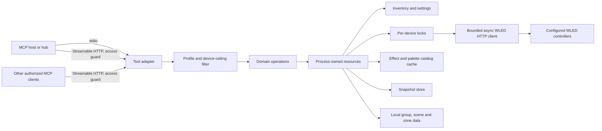

# Architecture

A short description of the components and the request and process lifecycle. Behavior,
parameters and error codes are specified in [TOOL-CONTRACT.md](TOOL-CONTRACT.md) and the
[contract files](TOOL-CONTRACT.md#stage-2-and-later-files); this page only shows how the pieces fit.
Features that are not yet released are described in their contract files, not here.

## Components

One `wled-mcp` process serves MCP over stdio (default) or Streamable HTTP. Both transports
build the same tool graph from the same domain operations.

- **Tool adapter** (`server.create_server` over `build_operations(resources)`): registers only the
  tools whose class is in the active profile and applies the per-device ceiling at dispatch;
  every device write also checks it in the write engines
  ([profiles](contract/profiles.md#enforcement)).
- **Domain operations** (`operations`, `patches`, `layouts`, `presets`, `preset_writes`,
  `preset_tools`, `groups`, `scenes`, `zones`, `explain`, `live_snapshot` and others): pure planning
  and validation plus the verified write routines. No transport code lives here.
- **Resources** (`resources`): one graph per process with the immutable inventory and settings
  (`config`), one managed async client (`client`), one lock per device, the catalog cache
  (`catalogs`), the snapshot store (`backups`) and the local group, scene and zone data. HTTP
  sessions do not own resources; all share the process graph.
- **Operations support:** `readmodels` normalizes `/json/state` and `/json/info`, `compat` classifies
  firmware, `diagnostics` holds correlation IDs, call logs and the status source.
- **Console commands** (`cli`, `setup`, `doctor`, `discovery`): `config`, `doctor` and `discover` run as
  separate short processes and never serve MCP ([contract/cli.md](contract/cli.md)).
- **HTTP only** (`http_config`, `http_service`): validated bind, allowlist and credential
  settings, and the access guard. The stdio path never imports these modules.

The device client sends fixed endpoints to configured controllers only. It follows no
redirects, uses no implicit proxy routing and sends no device credentials
([INVENTORY-CLIENT.md](INVENTORY-CLIENT.md)).

## Request lifecycle

For a mutation: resolve the device, take its process-local lock, read fresh state, validate the
whole request, take a snapshot when a stored preset would be lost, send the minimal payload,
read back within a bound, normalize the verification and return the result envelope. A dry run
stops before snapshots and writes. Reads get one bounded retry for a transient transport
failure; writes are never retried. There are no transactions: other clients and other server
processes do not share the lock, and nothing is rolled back across devices. Details are in
[TOOL-CONTRACT.md](TOOL-CONTRACT.md#results-and-errors); recovery steps are in
[TROUBLESHOOTING.md](TROUBLESHOOTING.md).

## Process lifecycle

- stdio opens no listener and keeps stdout for the protocol; diagnostics go to stderr.
- HTTP serves the fixed path `/mcp` on loopback by default, with one worker and stateless JSON
  responses (no session IDs, no replay). A header-only guard answers before any tool or device
  work: Host or Origin not allowed 403, bearer credential 401, other path 404, other method 405.
- SIGINT and SIGTERM stop admission, drain in-flight calls within the operation deadline and
  close the shared resources. A forced stop leaves a write in flight uncertain; nothing resumes
  on restart. The rule for both transports is in
  [Transport access and lifecycle](TOOL-CONTRACT.md#transport-access-and-lifecycle).

## Configuration and data

`--config` and `--data-dir` (or `WLED_MCP_CONFIG` and `WLED_MCP_DATA_DIR`, the options win) must
be absolute paths. Startup validates the inventory without probing or writing a device. The
released version reads it once, so changes need `wled-mcp config validate` and a restart
([DEPLOYMENT.md](DEPLOYMENT.md#changing-the-inventory)); an example is
[examples/devices.example.toml](../examples/devices.example.toml).

The snapshot store keeps `backups/<device_id>/<backup_id>.json` under the data directory. A
snapshot is taken before an overwrite or delete of a preset, 20 per device are kept and a restore
is an explicit `wled_restore_preset` call; a failed write triggers no automatic rollback
([snapshot contract](TOOL-CONTRACT.md#snapshot-and-explicit-restoration),
[presets](contract/presets.md#restore-wled_restore_preset)).

No database, web UI or extra daemon is needed. HTTP mode runs one worker, and locks are per
process, so one writer per controller.

## Where claims live

| Topic | Canonical source |
| --- | --- |
| Support, platforms, WLED firmware versions | [contract/compatibility.md](contract/compatibility.md), [DEC-020](DECISIONS.md#dec-020--support-and-version-policy) |
| License | `LICENSE`, `NOTICE`, [DEC-011](DECISIONS.md) |
| Identity (unofficial, unaffiliated) | [DEC-012](DECISIONS.md) |
| Contact and security | [SECURITY.md](../SECURITY.md), [DEC-013](DECISIONS.md) |
| Tools, results and errors | [TOOL-CONTRACT.md](TOOL-CONTRACT.md) |
| Validation and hardware evidence | [VALIDATION.md](VALIDATION.md), [TRACEABILITY.md](TRACEABILITY.md) |
| Deployment, update, rollback | [DEPLOYMENT.md](DEPLOYMENT.md) |
| Failure recovery | [TROUBLESHOOTING.md](TROUBLESHOOTING.md) |
| Dependencies and Python range | [contract/dependencies.md](contract/dependencies.md), `pyproject.toml` |
| Why the project is not an upstream fork | [SOURCES.md](SOURCES.md) |
