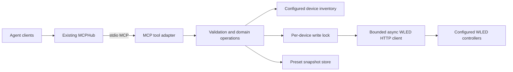

# Proposed architecture and decisions

## Components



Suggested package layout after bootstrap:

```text
src/wled_mcp/
  __init__.py
  server.py       # MCP tools, schemas, result formatting
  config.py       # TOML validation and device resolution
  client.py       # bounded HTTP calls; no domain decisions
  models.py       # typed requests, capabilities, outcomes
  operations.py   # patch/replace/preset workflows
  backups.py      # atomic preset snapshots and retention
tests/
  unit/
  integration/    # mocked HTTP and real stdio protocol, no LAN
  fixtures/       # sanitized synthetic WLED responses
```

The layout is guidance; a smaller coherent implementation is preferable to unnecessary abstraction.

## Decision register

| Decision | Status | Rationale / consequence |
| --- | --- | --- |
| Independent private repository | Confirmed | Requested by Kai; remains private |
| Documentation and issue backlog before implementation | Confirmed | Current assignment ends with an actionable handoff |
| Python, async HTTP, official MCP SDK | Proposed | Fits existing hub ecosystem and small adapter scope; choose maintained compatible versions at bootstrap |
| Python 3.12+ baseline, test 3.13 if used by hub | Proposed | Final support range depends on selected SDK and actual runtime; do not install/change hub Python merely to meet a proposal |
| stdio only for v1 | Proposed | Hub already provides remote access/authentication; avoids another service and OAuth stack |
| Explicit named inventory | Proposed | Predictable target selection; avoids Docker multicast/mDNS assumptions |
| No arbitrary caller-supplied hosts | Proposed | Limits tool targeting to the configured installation and removes accidental host selection |
| Separate segment patch and layout replacement | Proposed core contract | Prevents stale fields and unintended deletion; finalize missing-field behavior before code |
| Typed operations before optional raw state | Proposed | Clear agent schemas and validation; raw tool must not bypass domain rules |
| Direct implementation rather than upstream fork | Proposed | Existing candidates have useful ideas but material limitations; no upstream code copied |
| No public license selected | Open | User requested private work; future reuse/publication needs a decision |

## Configuration

See [example inventory](../examples/devices.example.toml). Configuration path is supplied explicitly through `--config`; data path through `--data-dir`. Paths must be absolute in deployed configuration. Startup validates configuration without probing or writing devices. Use atomic replacement for future reload support.

Suggested environment precedence: CLI paths override dedicated `WLED_MCP_CONFIG`/`WLED_MCP_DATA_DIR`; absent values cause an actionable startup failure rather than guessing a household file. Do not embed actual URLs or credentials in source. HTTP(S) root URLs may use explicit ports. Disable redirects by default; do not follow a configured controller to an arbitrary host. Avoid implicit proxy environment routing for LAN calls unless deliberately configured.

## Device operations

Reuse one managed async HTTP client with bounded connections, close it on process exit, and use operation deadlines. Reads can use a single bounded retry for transient transport failures; parse errors and invalid requests are not retry candidates. Writes are never automatically retried.

For a mutation: resolve device -> acquire its process-local lock -> obtain required fresh information -> validate the whole operation -> prepare backup if necessary -> issue minimal payload -> bounded readback -> normalized verification -> return structured outcome. A dry run stops before backups and writes, reports no persistent side effects, and does not reserve a preset slot.

Do not claim transactions. Other WLED API clients and another server process do not share the lock. Detect conflicts when observable and return a mismatch/uncertain result; do not overwrite repeatedly to make a verification pass. Multi-device use does not provide synchronized frames or rollback across controllers.

## Backups

Use JSON snapshots with a versioned envelope, generated backup ID, UTC timestamp, configured device ID and relevant firmware/preset metadata. Write a temporary file in the same directory, flush/close and atomically replace the destination; snapshot filenames derive from validated IDs, never unsanitized user names. Preserve unknown preset fields. Validate snapshots before considering backup successful.

Proposed retention is 20 snapshots per controller, configurable; prune only valid older snapshot files in the resolved backup directory, only after a new snapshot is durable, and never remove the snapshot needed by the operation in progress. Data remains outside version control. If the path is not persistent/writable, destructive preset operations fail before touching WLED. Restore is explicit; a failed write does not trigger an automatic compensating mutation.

## Compatibility

At first inventory capture, document observed firmware/API variants and supported features. Capabilities can be missing or inconsistent; model unknown separately from unsupported. Effect/palette metadata is optional even when basic catalogs work. Unknown response fields should not break parsing; malformed required data should fail clearly. Establish the minimum supported WLED version from the API features used and verified compatibility evidence.

## Resource and dependency policy

No database, web UI or extra daemon. Measure rather than promise Pi memory/latency. Lock dependencies, retain package build metadata, and keep runtime reproducible. Revisit this decision if a maintained WLED client library demonstrably reduces complexity; evaluate its version support and license before adding it.
