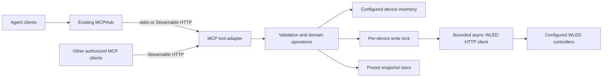

# Proposed architecture and decisions

Issue #4 implements one process-owned `Resources` graph: immutable configured
inventory/settings, one managed async client, stable per-device locks, shared
effect/palette catalog cache (`metadata_cache`, issue #5) and the snapshot store (issue #8,
`backups.py`; per-device retention enforced) and the five persistent-preset tools (issue #9: `presets.py` pure
store parsing/classification/capture comparison, `Resources.write_polled` for the single-POST polled-readback write). Tool factories close over the same graph; the CLI opens/serves/closes
it in one async lifecycle. The [bounded client profile](INVENTORY-CLIENT.md) and
[decisions](decisions/issue-4.md) are current implementation details.

Issue #5 adds read-only state/catalog tools: `readmodels.py` (pure normalization of
`/json/state` and `/json/info`, redaction), `catalogs.py` (ID-preserving catalogs,
optional fxdata, firmware-aware cache, internal name resolver) and three operations in
`operations.py`. Reads take the per-device lock and one deadline; the injectable
`Clock` lives on `Resources`. See [TOOL-CONTRACT](TOOL-CONTRACT.md#read-tools-state-and-catalogs-implemented-in-5)
and [decisions](decisions/issue-5.md). Durable snapshots are implemented by #8 and the
multi-session HTTP service by #14.

## Components

Issue #3 implements the bootstrap using Python 3.13 and official MCP SDK 2.3.0.
`server.create_server` is the common explicit operation factory;
`models.Outcome` is transport-independent. The default registry is empty.
[Issue-3 decisions](decisions/issue-3.md) record narrow configuration and safe
HTTP staging; [development commands](DEVELOPMENT.md) describe locked build and
installed-wheel/uvx checks. The graph below describes downstream implementation.



Suggested package layout after bootstrap:

```text
src/wled_mcp/
  __init__.py
  server.py       # MCP tools, schemas, result formatting
  config.py       # TOML validation and device resolution
  client.py       # bounded HTTP calls; no domain decisions
  models.py       # typed requests, capabilities, outcomes
  operations.py   # patch/replace/preset workflows
  presets.py      # preset requests, store parsing/classification, capture comparison (pure)
  backups.py      # atomic preset snapshots and retention
tests/
  unit/
  integration/    # mocked WLED HTTP, real stdio and loopback MCP HTTP, no LAN
  fixtures/       # sanitized synthetic WLED responses
```

The layout is guidance; a smaller coherent implementation is preferable to unnecessary abstraction.

## Decision register

| Decision | Status | Rationale / consequence |
| --- | --- | --- |
| Independent repository | Confirmed | Requested by the project owner as a private repository; [DEC-009](DECISIONS.md#dec-009--public-ready-repository-baseline) keeps its content public-ready, and visibility is an owner release decision ([#23](https://github.com/descipar/wled-mcp/issues/23)) |
| Documentation and issue backlog before implementation | Confirmed | Current assignment ends with an actionable handoff |
| Python, async HTTP, official MCP SDK | Proposed | Fits MCPHub-style hosts and small adapter scope; choose maintained compatible versions at bootstrap |
| Python 3.12+ baseline, test 3.13 if used by hub | Proposed | Final support range depends on selected SDK and actual runtime; do not install/change hub Python merely to meet a proposal |
| Streamable HTTP plus stdio in v1 | Confirmed scope update | Independent service mode plus client-managed uvx mode; identical tools and domain layer |
| One HTTP worker, SDK stateless JSON responses | Issue-2 technical design | No session IDs/replay store; shared process-wide resources and locks; bounded drain, access checks before device work; implemented in #14 ([decisions](decisions/issue-14.md)) |
| Explicit named inventory | Proposed | Predictable target selection; avoids Docker multicast/mDNS assumptions. From M8, discovery is an explicit, bounded, read-only aid; the inventory stays the only source of targets ([DEC-035](DECISIONS.md#dec-035--agent-driven-discovery-and-enrollment)) |
| No arbitrary caller-supplied hosts | Proposed | Limits tool targeting to the configured installation and removes accidental host selection. From M8 the one bounded exception is `wled_add_device` (RFC 1918 IPv4 literal, one `GET /json/info`, class `manage`), plus the configured discovery ranges ([contract/discovery.md](contract/discovery.md)) |
| Separate segment patch and layout replacement | Issue-2 technical design | Preserve existing omitted state; new IDs use explicit defaults; reject unrepresentable ID/preservation plans; see contract and decisions |
| Typed operations before optional raw state | Proposed | Clear agent schemas and validation; raw tool must not bypass domain rules |
| Direct implementation rather than upstream fork | Proposed | Existing candidates have useful ideas but material limitations; no upstream code copied |
| No public license selected | Open | License and publication remain owner decisions ([#23](https://github.com/descipar/wled-mcp/issues/23)) |

## Configuration

See [example inventory](../examples/devices.example.toml). Configuration path is supplied explicitly through `--config`; data path through `--data-dir`. Paths must be absolute in deployed configuration. Startup validates configuration without probing or writing devices. Use atomic replacement for future reload support (M8 adds an in-process reload for tool-made changes, see [contract/discovery.md](contract/discovery.md)).

Suggested environment precedence: CLI paths override dedicated `WLED_MCP_CONFIG`/`WLED_MCP_DATA_DIR`; absent values cause an actionable startup failure rather than guessing an installation's file. Do not embed actual URLs or credentials in source. HTTP(S) root URLs may use explicit ports. Disable redirects by default; do not follow a configured controller to an arbitrary host. Avoid implicit proxy environment routing for LAN calls unless deliberately configured.

## Device operations

Build the same tool/domain graph for either explicitly selected transport. In HTTP mode create shared resources once per process, not per request/session; all sessions share the same device locks and backup store. Use the maintained SDK for `/mcp`, protocol negotiation and session handling. One worker is the v1 baseline; multiple worker processes need cross-process coordination before they can provide equivalent write guarantees.

CLI stdio is the default and opens no listener; `--transport streamable-http` starts the independent service with explicit bind/port options. HTTP defaults to loopback. Private container-network binding and the actual allowlist/secret values remain deployment configuration. The contract fixes loopback port 8000, exact allowlists, mandatory auth on every method and fail-closed startup; no HTTP credential is required for stdio. Protect the endpoint independently of the hub, without inventing a new OAuth product. Use SDK-supported stateless JSON responses with no session IDs or replay store, as specified in [the transport contract](TOOL-CONTRACT.md#transport-access-and-lifecycle). Test initialization, auth/Host/Origin rejection, reconnect and bounded shutdown without replay. #3 selects a compatible SDK; #14 implements this lifecycle.

Issue #14 implementation: `http_config.py` validates bind/allowlist/credential settings
before any listener exists; `http_service.py` wraps the SDK stateless JSON app in a
header-only access guard (Host 403, Origin 403, bearer 401, path 404, non-POST 405)
and runs one uvicorn worker that owns SIGINT/SIGTERM and drains within the operation
deadline. `cli.py` imports it only for `--transport streamable-http`; stdio never
loads it. Both transports call `create_server(build_operations(resources))`.

Reuse one managed async HTTP client with bounded connections, close it on process exit, and use operation deadlines. Reads can use a single bounded retry for transient transport failures; parse errors and invalid requests are not retry candidates. Writes are never automatically retried.

For a mutation: resolve device -> acquire its process-local lock -> obtain required fresh information -> validate the whole operation -> prepare backup if necessary -> issue minimal payload -> bounded readback -> normalized verification -> return structured outcome. A dry run stops before backups and writes, reports no persistent side effects, and does not reserve a preset slot.

Do not claim transactions. Other WLED API clients and another server process do not share the lock. Detect conflicts when observable and return a mismatch/uncertain result; do not overwrite repeatedly to make a verification pass. Multi-device use does not provide synchronized frames or rollback across controllers.

## Backups

Use the [version-1 snapshot envelope](TOOL-CONTRACT.md#snapshot-and-explicit-restoration), generated backup ID, UTC timestamp, configured device ID and relevant firmware/preset metadata. Single-entry restoration execution remains Should until a safe storage-only path is verified; exporting a snapshot is not a restoration test. Layout `backups/<device_id>/<backup_id>.json`; write an exclusive same-directory temporary file, fsync, validate, publish without overwrite and best-effort fsync the directory (details in the contract); snapshot filenames derive from validated IDs, never unsanitized user names. Preserve unknown preset fields. Validate snapshots before considering backup successful.

Retention is 20 snapshots per controller, configurable; prune only valid older snapshot files in the resolved backup directory, only after a new snapshot is durable, and never remove the snapshot needed by the operation in progress. Data remains outside version control. If the path is not persistent/writable, destructive preset operations fail before touching WLED. Restore is explicit; a failed write does not trigger an automatic compensating mutation.

## Compatibility

At first inventory capture, document observed firmware/API variants and supported features. Capabilities can be missing or inconsistent; model unknown separately from unsupported. Effect/palette metadata is optional even when basic catalogs work. Unknown response fields should not break parsing; malformed required data should fail clearly. Establish the minimum supported WLED version from the API features used and verified compatibility evidence.

## Resource and dependency policy

HTTP mode runs one independent service; stdio mode is client-managed. No database, web UI or additional supporting daemon is required. Measure rather than promise Pi memory/latency in each mode. Lock dependencies, retain package build metadata, and keep runtime reproducible. Revisit this decision if a maintained WLED client library demonstrably reduces complexity; evaluate its version support and license before adding it.
