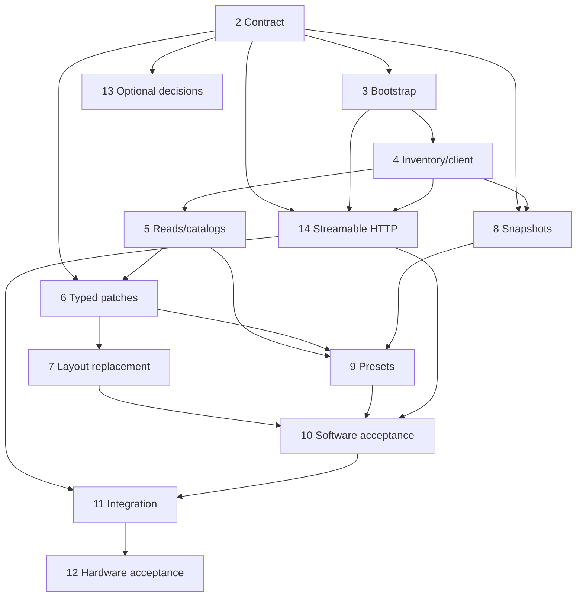

# Stage-1 implementation plan and GitHub backlog

Status: all issues below are open at planning handoff, 2026-11-04. Live GitHub state takes precedence over this initial status snapshot. No code has been implemented.

## Delivery tracker

[Issue #1 — Epic: deliver the first usable WLED MCP server](https://github.com/descipar/wled-mcp/issues/1) is the parent of issues #2–#14. Its closure requires the release evidence described in REQUIREMENTS.md, including both confirmed transports; merely closing software tasks does not prove hardware acceptance.

## Work packages

| Order | Issue | Depends on | Main requirements / evidence |
| --- | --- | --- | --- |
| 1 | [#2 — Finalize tool contract and layout/preset semantics](https://github.com/descipar/wled-mcp/issues/2) | None | CTRL-01, SEG-01–04, PRE-01–05, MCP-02; settle observable outcomes |
| 2 | [#3 — Package, uvx launch and selectable transports](https://github.com/descipar/wled-mcp/issues/3) | #2 | MCP-01–02, OPS-01–03, TEST-01; T14/T16, HTTP foundation |
| 3 | [#4 — Inventory and bounded HTTP client](https://github.com/descipar/wled-mcp/issues/4) | #3 | DEV-01–02, REL-01–03, MULTI-01, OPS-03; T01/T02/T09/T10/T15 |
| 4 | [#5 — State, capabilities and catalogs](https://github.com/descipar/wled-mcp/issues/5) | #4 | READ-01–03, DEV-02, OPS-04; T02/T03/T15 |
| 5 | [#6 — Typed master/segment patches](https://github.com/descipar/wled-mcp/issues/6) | #2, #5 | CTRL-01, SEG-01/03/04, REL-02–03; T04/T06–T10 |
| 6 | [#7 — Full layout replacement](https://github.com/descipar/wled-mcp/issues/7) | #6 | SEG-02–05, MULTI-01, REL-03; T05–T10 |
| 4+ | [#8 — Preset snapshot store and restoration](https://github.com/descipar/wled-mcp/issues/8) | #2, #4 | PRE-04, OPS-02–03, REL-02; T12 |
| 7 | [#9 — Persistent preset operations](https://github.com/descipar/wled-mcp/issues/9) | #5, #6, #8 | PRE-01–05, PLAY-01, REL-02; T11–T13 |
| 4+ | [#14 — Streamable HTTP service and shared multi-client handling](https://github.com/descipar/wled-mcp/issues/14) | #2, #3, #4 | MCP-01–04, MULTI-01, REL-01–03, OPS-01/03/05; T18–T21 |
| 8 | [#10 — Acceptance tests and evidence traceability](https://github.com/descipar/wled-mcp/issues/10) | #7, #9, #14 | TEST-01 and all Must software behavior; T01–T16, T18–T21 |
| 9 | [#11 — HTTP-service and uvx/stdio integration](https://github.com/descipar/wled-mcp/issues/11) | #10, #14 | OPS-01–05, MCP-01–04; T14/T16/T18–T21, authorized H02/H03 |
| 10 | [#12 — Device inputs and hardware acceptance](https://github.com/descipar/wled-mcp/issues/12) | #11 for final execution | Relevant Must hardware evidence; H01–H07 as applicable |
| Optional | [#13 — Should/Later feature decisions](https://github.com/descipar/wled-mcp/issues/13) | #2 | DEV-03, SEG-05–06, PRE-03, PLAY-01, ADV-01–02; T17 if raw tool included |

Each issue contains its own scope, acceptance checklist, dependencies and relevant requirement IDs. #8 and #14 can proceed after #4 while read/control work progresses. Inventory collection for #12 can start earlier; only final integration/hardware execution depends on #11. The optional issue is not a requirement to build all later features before v1. Streamable HTTP is required scope, not an optional enhancement in #13.

## Dependency view

## Execution policy

Work in small reviewable changes linked to issues. Introduce tests with the relevant implementation; #10 consolidates acceptance and does not postpone all testing until the end. Record deviations in the affected docs/issues. Add implementation commands to README only after verifying them against the installed artifact.

Missing actual device addresses must not block issues #2–#10. Physical writes and hub deployment follow the later user's actual authorization; a planning issue is not itself such authorization. Keep software completion distinct from deployment and hardware evidence.

## Requirement traceability maintenance

Requirement IDs are linked in the table and issue bodies; detailed expected test evidence is in VALIDATION.md. As implementation proceeds, add test names/paths, PR/commit links and actual run results to the corresponding issues. Do not replace this chain with a test-count target. All Must IDs must retain at least one owning issue and an acceptance scenario; optional omissions need a recorded decision.

## Stage 2 — public project and product extensions

[Tracker #15](https://github.com/descipar/wled-mcp/issues/15) and child issues #16–#25 form a separate `stage:2` backlog. See [the roadmap and issue map](STAGE-2.md) for proposed Launch versus Should priorities and [marketplace research](MARKETPLACE.md) for distinct submission paths. Stage-1 #1 does not wait for every stage-2 feature. Public stable launch waits for relevant stage-1 evidence; stage-2 preparation can proceed earlier.
